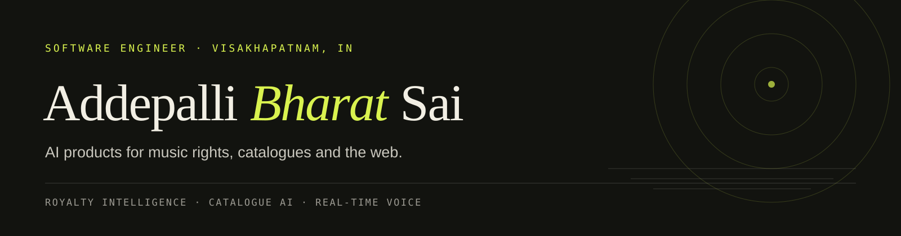

**Software engineer building AI products for music rights, catalogues and the web.**
Visakhapatnam, India · remote · open to select freelance work

Currently at **Dotted Eighth LLC**, building a royalty-intelligence platform and a music AI
suite over a 55,000-work classical catalogue.

**Focus**
- Royalty intelligence — statements, cue sheets, catalogue matching, valuation, review queues.
- Catalogue AI — React chat with SSE, sheet-music PDF analysis, data-quality checks.
- Real-time voice — NestJS microservices, WebRTC audio, LLM pipelines.

**Stack**  
`TypeScript` `React` `Next.js` `Node.js` `NestJS` `PostgreSQL` `Prisma` `Redis` `Python` `Docker` `Azure` `LLM pipelines`

**Selected work**  
[Cancer biomarker app](https://github.com/ABharatSai/Cancer-Prediction-App) ·
[Crowdsourced medicine](https://github.com/ABharatSai/CSPM) ·
[Sentiment analysis](https://github.com/ABharatSai/Sentiment_Analysis-using-NLP) ·
[DropNet, reproduced](https://github.com/ABharatSai/DropNet_Reproduced_Results)

**Contact**  
[LinkedIn](https://www.linkedin.com/in/addepalli-bharat-sai-89b376193/) ·
[Email](mailto:addepallibharatsai2001@gmail.com) ·
[Archive account](https://github.com/ABharatSai)
